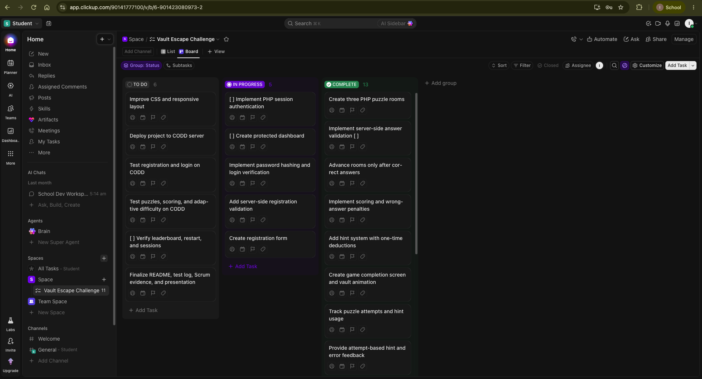
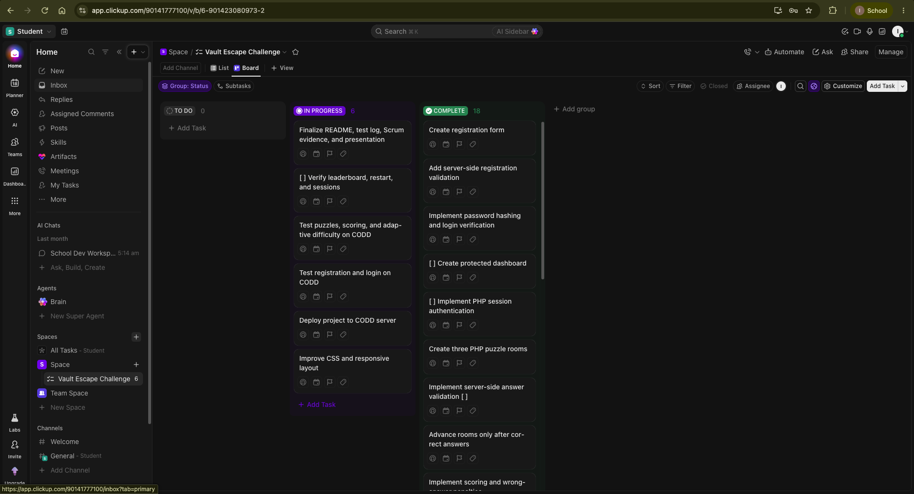
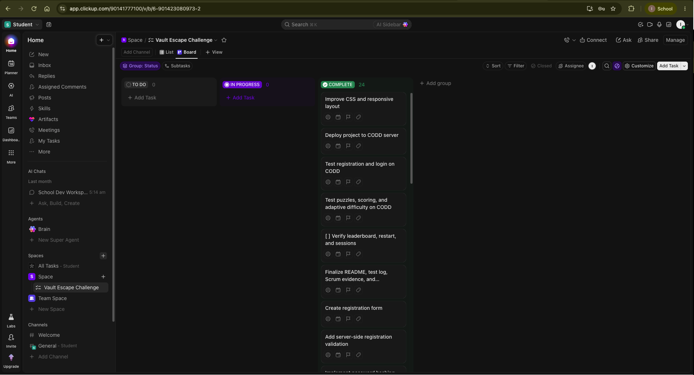

# Vault Escape Challenge - Sprint Journal

Course: CSC 6370 - Web Programming
Student: Isaac Owusu
Semester: Fall 2026
Project Type: Individual Project

## Overview

I developed Vault Escape Challenge individually and used Scrum-style planning to organize my work into six short development stages.

I used ClickUp to track tasks through To Do, In Progress, and Complete. I also used GitHub commits to track code changes.

This journal is a retrospective summary of the six development stages. It is based on the completed project, development work, and ClickUp task board.

ClickUp Board:
https://sharing.clickup.com/90141777100/b/h/6-901423080973-2/76f0227e30f6a62

GitHub Repository:
https://github.com/isaacowusu3461/Owusu_VaultEscapeChallenge

## Sprint 1 - Planning and Project Setup

### Sprint Goal

Plan the escape room application and establish the basic project structure.

### Planned Tasks

- Review Project 2 requirements.
- Select The PHP Vault as the project topic.
- Prepare the project proposal.
- Design the initial page wireframes.
- Create the GitHub repository.
- Set up the project structure.

### Work Completed

I selected The PHP Vault because it allowed me to build an interactive PHP game using sessions, forms, and server-side logic.

I planned a three-room escape challenge with registration, login, scoring, hints, and a leaderboard.

I also prepared the initial design and organized the files for the project.

### Progress Review

The main goal of this stage was to understand the assignment and decide how the application would work.

I identified the main pages and features before moving into implementation.

### Challenges

One challenge was deciding how to connect the different features without making the project unnecessarily complicated.

I decided to keep the application focused on three puzzle rooms and build the supporting features around them.

### Retrospective

Planning the project first made the implementation easier because I had a clear idea of the pages and functionality I needed.

## Sprint 2 - Registration, Login, and Sessions

### Sprint Goal

Implement user accounts and session-based authentication.

### Planned Tasks

- Create the registration form.
- Add server-side validation.
- Implement password hashing.
- Create the login form.
- Build the protected dashboard.
- Implement PHP session authentication and logout.

### Work Completed

I implemented registration and login using PHP.

The registration form validates user input and checks for duplicate accounts.

Passwords are hashed before storage and verified during login.

I also added session-based authentication so users can access protected pages after logging in.

The dashboard became the main starting point for the game.

### Progress Review

The main account features were implemented, including registration, login, protected pages, and logout.

### Challenges

I needed to make sure users could not access protected pages without logging in.

I also had to keep authentication state consistent when users moved between pages.

### Retrospective

This stage helped me understand PHP sessions and how they can be used to maintain user authentication across multiple requests.

## Sprint 3 - Puzzle Rooms, Scoring, and Hints

### Sprint Goal

Implement the main escape room gameplay.

### Planned Tasks

- Create three puzzle rooms.
- Add PHP answer validation.
- Implement room progression.
- Add incorrect-answer penalties.
- Implement the hint system.
- Create the game completion screen.

### Work Completed

I implemented three puzzle rooms with different challenges.

Players submit their answers through PHP forms. The server checks the answers before allowing them to advance.

I added a scoring system with penalties for incorrect answers and hint requests.

I also made sure requesting the same hint repeatedly would not cause repeated deductions.

After the final puzzle, the application displays the results and the vault door animation.

### Progress Review

The main game became playable from beginning to end.

The scoring and hint systems were connected to the game state.

### Challenges

One challenge was making sure players could not skip rooms or advance without solving the current puzzle.

Another was preventing repeated hint deductions.

### Retrospective

This stage showed me how important server-side validation is when building an interactive PHP application.

## Sprint 4 - Adaptive AI Implementation

### Sprint Goal

Implement the required AI baseline and graduate extension.

### Planned Tasks

- Track incorrect attempts.
- Track hint usage.
- Provide attempt-based feedback.
- Measure room completion time.
- Implement adaptive difficulty.
- Explain difficulty changes.

### Work Completed

I implemented a rule-based adaptive difficulty system using PHP.

The system tracks information about player performance, including mistakes, hint usage, and time spent solving a room.

It uses these measurements to select Easy, Normal, or Hard difficulty for the next room.

I also added feedback to help players understand their performance and why the difficulty changed.

The difficulty remains fixed after the player enters a room.

### Progress Review

The adaptive difficulty system was integrated into the game.

The graduate extension was tested using separate automated test cases.

### Challenges

One challenge was deciding how to evaluate performance fairly.

I also needed to make sure the difficulty did not change while a player was solving the current puzzle.

### Retrospective

I learned that a rule-based AI feature can be useful without an external AI service.

The most important part was making the decision rules understandable and connecting them to actual player performance.

## Sprint 5 - Leaderboard, Security, and Testing

### Sprint Goal

Complete the supporting features and improve application reliability.

### Planned Tasks

- Implement the leaderboard.
- Add player statistics.
- Save completed game results.
- Improve input validation.
- Add security checks.
- Create automated PHP tests.
- Configure GitHub Actions.

### Work Completed

I implemented the leaderboard and player statistics so users could review their game results.

I also added security checks, including CSRF protection, output escaping, and server-side validation.

I created automated tests for application functionality, security, and adaptive difficulty.

The local testing results were:

- Application tests: 32 passed
- Security tests: 11 passed
- Graduate AI tests: 17 passed

Total: 60 automated tests passed.

I also configured GitHub Actions to support automated checking.

### Progress Review

The main supporting features were completed and tested locally.

The application was ready for final interface improvements and deployment testing.

### Challenges

I needed to test more than just the normal gameplay.

I also had to consider invalid input, repeated actions, and security-related cases.

### Retrospective

Automated testing helped me find problems earlier and made it easier to check that changes did not break existing functionality.

## Sprint 6 - UI Improvements, CODD Deployment, and Documentation

### Sprint Goal

Finalize the interface, deploy the project, and prepare the submission materials.

### Planned Tasks

- Improve the CSS design.
- Check responsive layouts.
- Deploy the application to CODD.
- Test the deployed website.
- Update the README.
- Prepare the test log.
- Organize Scrum evidence.
- Prepare the final presentation and submission.

### Work Completed

I updated the website's colors and layout using a charcoal, burgundy, and cream color palette.

I deployed the project to Georgia State University's CODD server.

I then tested the application through my browser.

The following six deployment tests passed:

1. Homepage and UI
2. Registration and login
3. Puzzle rooms and scoring
4. Adaptive difficulty
5. Leaderboard and statistics
6. Restart, logout, and session security

I also prepared the README and test log and organized the ClickUp screenshots showing task progress.

### Progress Review

The implementation and six CODD deployment tests were completed successfully.

The final presentation and submission materials are tracked separately and should be confirmed before submission.

### Challenges

CODD restricts external access, so I had to verify the deployed application directly through my browser.

I also needed to check that registration, sessions, and game data worked correctly on the deployed server rather than relying only on local testing.

### Retrospective

Deploying the project helped me understand how a PHP application behaves outside my local development environment.

The final tests also helped confirm that the main features worked together correctly.

## ClickUp Task Progress Evidence

I used ClickUp to track project tasks throughout development.

The screenshots show three stages of task progress.

### Screenshot 1 - Initial Recorded Progress

- To Do: 6
- In Progress: 5
- Complete: 13

### Screenshot 2 - Later Recorded Progress

- To Do: 0
- In Progress: 6
- Complete: 18

### Screenshot 3 - Final Task Completion

- To Do: 0
- In Progress: 0
- Complete: 24

These screenshots demonstrate how tasks moved through the different statuses.

They do not individually represent six sprint meetings, but they support the overall development record.

